# MTR Controller PWA

An example **persistent web app (PWA)** that turns a Room Navigator into a simple Microsoft Teams Rooms (MTR) style control panel for a paired Cisco device running MTR. The Navigator loads the web app in persistent web app mode, and the web app talks to the device over its xAPI.

## What it can and can't control

The xAPI only exposes a handful of controls for the MTR in-call experience, so that is all this controller offers:

| When               | What you can control                                                                                                                  |
| ------------------ | ------------------------------------------------------------------------------------------------------------------------------------- |
| **In an MTR call** | Volume, camera mode selection (enhanced framing options or manual pan, tilt and zoom), camera mute and microphone mute                |
| **Out of a call**  | Start and stop sharing (presentation), plus a read-only date, time, device name and room calendar ( Required Hybrid-Calendar Enabled) |

Anything else the MTR app does (joining or leaving calls, whiteboard, meeting details, participants) can't be driven through the xAPI today, so it isn't shown.

## The experience

### Out of a call

The MTR theme shows the date, time and device name at the top left, a Share button, and a square volume rocker on the right. Everything sits on a wallpaper drawn with CSS/SVG that captures the feel of the Teams Rooms one. Turn on the room calendar in the macro config and the room's bookings (from `Bookings.List`) appear on the right, with the Share button centred in the left half.

|                                                    |                                                                |
| -------------------------------------------------- | -------------------------------------------------------------- |
| 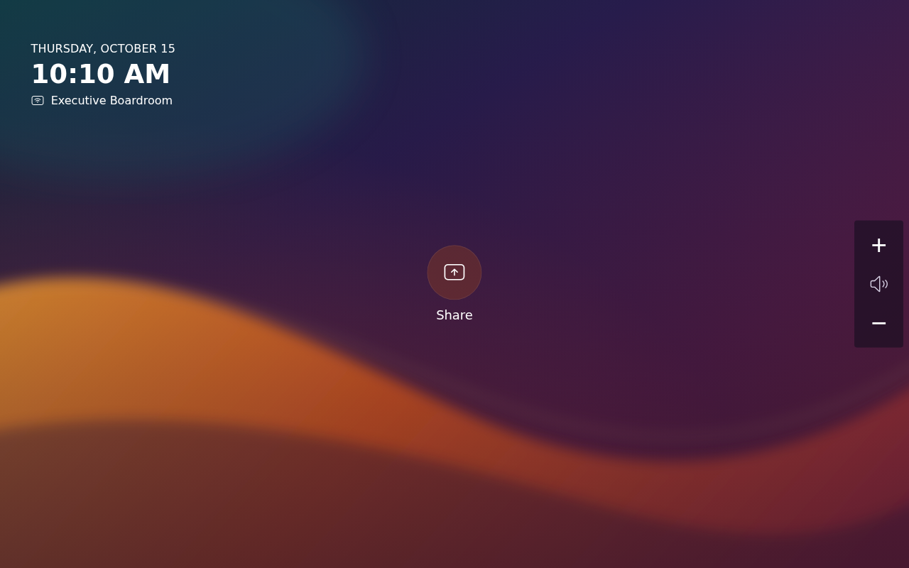            | 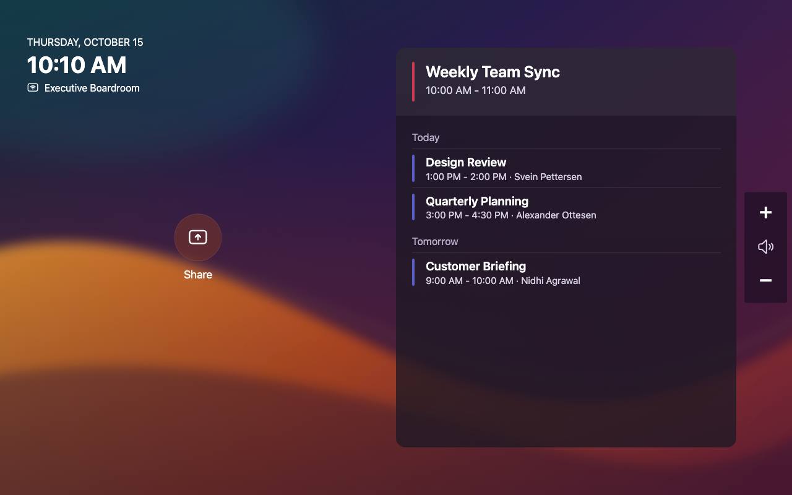 |
| Home, calendar off: the Share button is centred    | Home, calendar on: bookings on the right                       |
| 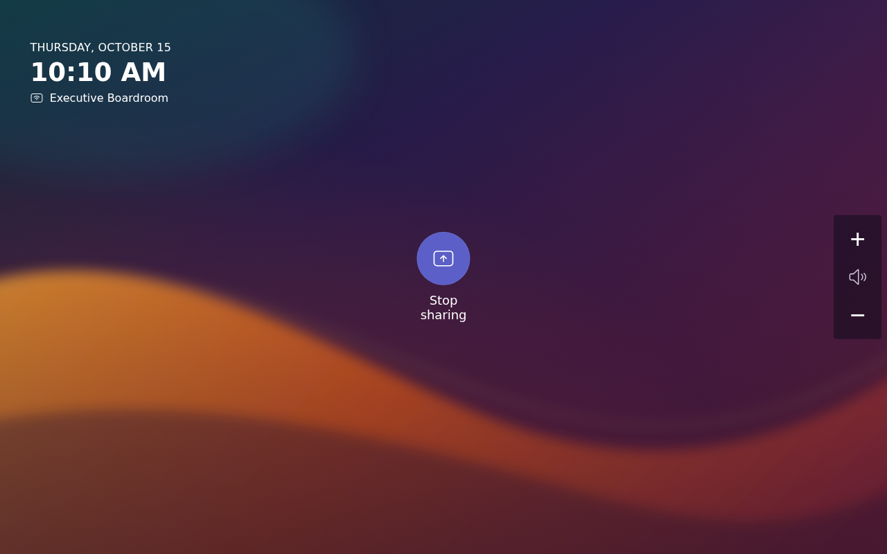 |                 |
| While sharing the button becomes "Stop sharing"    | Halfwake and standby are plain black                           |

The volume rocker shows a speaker icon and flashes the level for a couple of seconds whenever the volume changes, even when it was changed from another interface.

### In an MTR call

Only the controls the xAPI allows are shown: volume, camera (tap to mute, chevron for camera settings) and microphone mute. The time and device name stay at the top left over the Teams-style purple background.

|                                                             |                                                            |
| ----------------------------------------------------------- | ---------------------------------------------------------- |
| 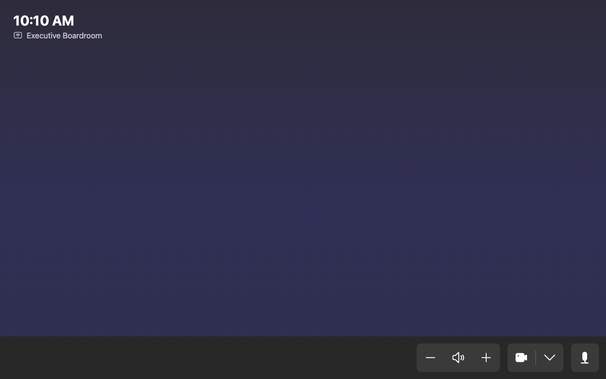                     | 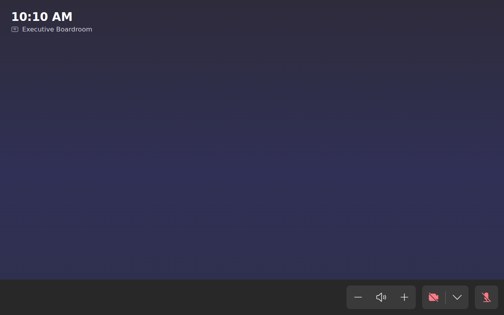        |
| In a call                                                   | Camera and microphone muted                                |
| 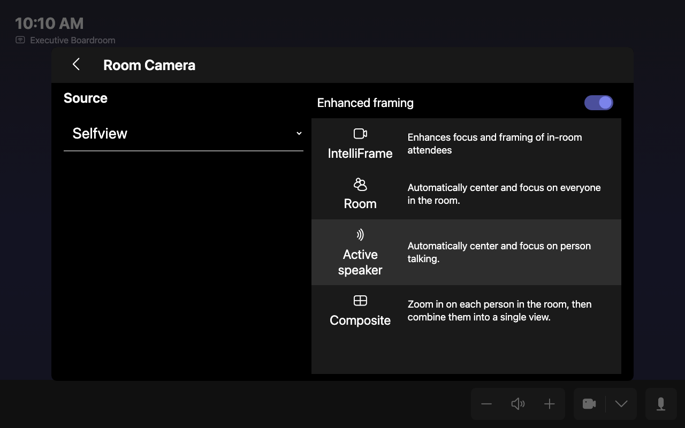 | 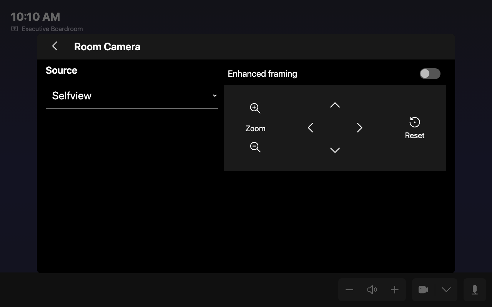 |
| Room Camera: enhanced framing on                            | Room Camera: manual pan, tilt and zoom                     |

The Room Camera modal closes with the back arrow or by tapping outside it. The enhanced framing options map to the SpeakerTrack behaviour on the device, and the highlighted one follows what the device reports:

| Option         | Behaviour set (`Cameras SpeakerTrack Set`) |
| -------------- | ------------------------------------------ |
| Room           | `BestOverview`                             |
| Composite      | `Dynamic`                                  |
| Active speaker | `Closeup`                                  |
| IntelliFrame   | `Frames`                                   |

The toggle itself uses `SpeakerTrack Activate` / `Deactivate`, and the manual controls use `Camera Ramp` while a button is held.

### Modes: Auto, RoomOS Only, MTR Only

A control panel button (optional) lets someone pick how the web app looks, which is handy for demoing the MTR UI on a device that isn't running MTR:

| Mode            | Out of call                            | In call                                                          |
| --------------- | -------------------------------------- | ---------------------------------------------------------------- |
| **Auto**        | MTR theme if the device is in MTR mode | MTR controls for a Teams call, RoomOS controls for a RoomOS call |
| **RoomOS Only** | RoomOS views                           | RoomOS controls                                                  |
| **MTR Only**    | MTR theme, even on a RoomOS device     | MTR controls for any call                                        |

For comparison, the RoomOS views:

|                                               |                                               |
| --------------------------------------------- | --------------------------------------------- |
| 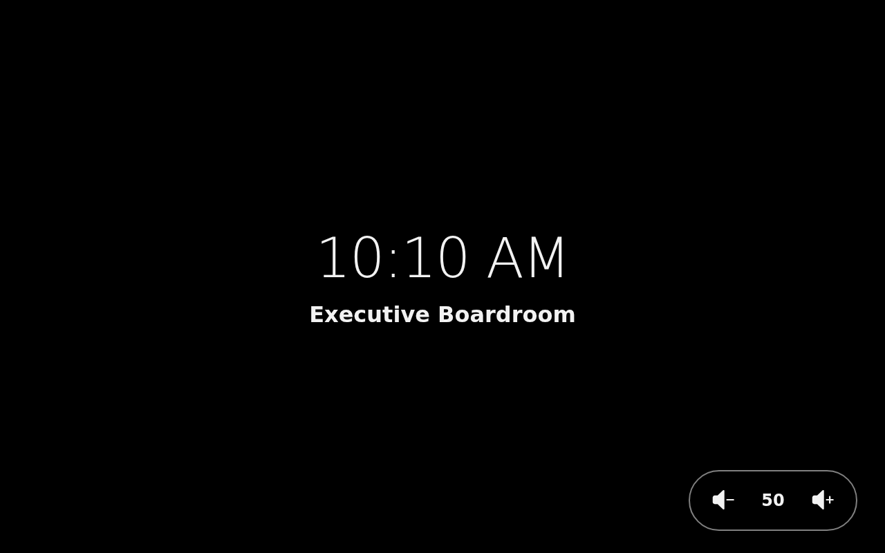 | 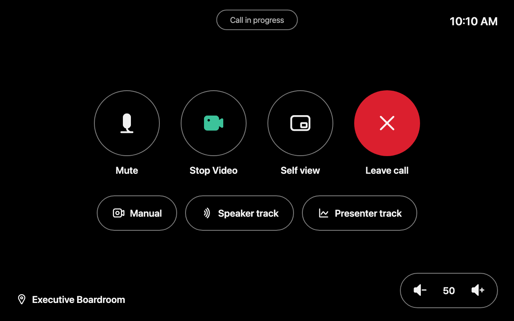 |

### Connecting and errors

While it connects (and retries after a failure) the web app shows a spinner, and a bad or incomplete URL shows what is wrong.

|                                             |                                                        |                                         |
| ------------------------------------------- | ------------------------------------------------------ | --------------------------------------- |
| 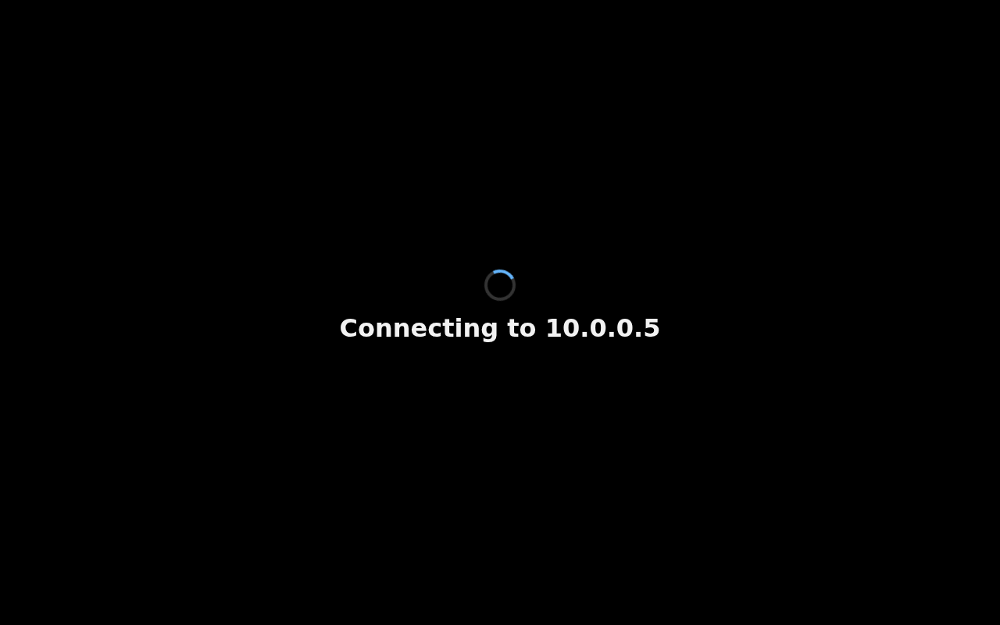 | 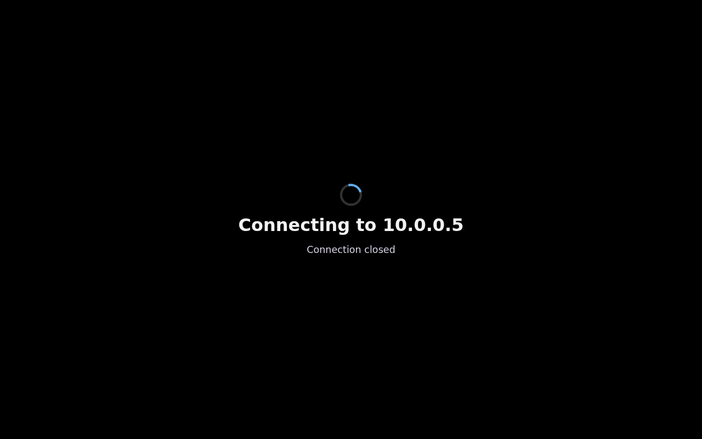 | 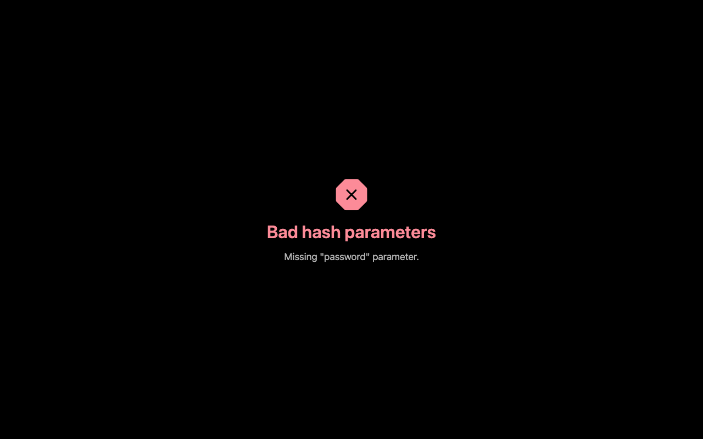 |
| Connecting                                  | Failed, retrying                                       | Missing a hash parameter                |

## How it works

### The macro

The macro runs on the MTR device and keeps the Navigator's web app URL up to date:

1. **Enables WebEngine** and device-certificate support so the web app can load and connect.
2. **Gets the device IP address** (IPv4, falling back to IPv6).
3. **Creates a local user account** (`pwa-controller`) with a random password and the roles in `ACCOUNT_ROLES`. If the account's roles ever drift, it adds or removes roles to fix them.
4. **Checks whether the device is in MTR mode** (`Command.MicrosoftTeams.List`, which rejects when no MTR container is installed).
5. **Writes the web app URL** to `Config UserInterface HomeScreen Peripherals WebApp URL`. The account, address and toggles are passed as base64 encoded JSON in the URL **hash**, after a `?timestamp=` search parameter (the WebEngine can get stuck when only the hash changes, so the changing timestamp forces a reload).
6. **Re-syncs** whenever the IP address or the URL changes, and when someone taps the mode button.

<picture>
  <source media="(prefers-color-scheme: dark)" srcset="assets/macro-overview-dark.svg">
  <source media="(prefers-color-scheme: light)" srcset="assets/macro-overview-light.svg">
  
</picture>

The hash looks like this (`demo` is only used for the documentation screenshots):

| Parameter                         | Meaning                                                           |
| --------------------------------- | ----------------------------------------------------------------- |
| `username`, `password`, `address` | The account the web app logs in with and the device to connect to |
| `mtrDevice`                       | `true` when the device is in MTR mode                             |
| `mode`                            | `Auto`, `RoomOS Only` or `MTR Only`                               |
| `calendar`                        | `true` to show the room calendar                                  |
| `demo`                            | A canned scene name, with no device needed                        |

### The web app

The web app is static (served from GitHub Pages) and does everything in the browser:

1. **Reads the URL hash** and shows an error view if it is missing or incomplete.

    

    
Web App Hash Parameter Flowchart

    <picture>
      <source media="(prefers-color-scheme: dark)" srcset="assets/pwa-hash-params-dark.svg">
      <source media="(prefers-color-scheme: light)" srcset="assets/pwa-hash-params-light.svg">
      
    </picture>

    

2. **Connects** to the device with `jsxapi` over `wss`, retrying every few seconds if it fails.
3. **Queries, then subscribes** to the xStatus values it needs: standby state, Teams call state, active calls, volume, mute states, camera mode, presentation, SpeakerTrack behaviour and bookings.
4. **Picks a view** on every status change, then themes it from `mtrDevice` and `mode`.

<picture>
  <source media="(prefers-color-scheme: dark)" srcset="assets/pwa-connect-dark.svg">
  <source media="(prefers-color-scheme: light)" srcset="assets/pwa-connect-light.svg">
  
</picture>

<picture>
  <source media="(prefers-color-scheme: dark)" srcset="assets/pwa-choose-view-dark.svg">
  <source media="(prefers-color-scheme: light)" srcset="assets/pwa-choose-view-light.svg">
  
</picture>

<picture>
  <source media="(prefers-color-scheme: dark)" srcset="assets/pwa-views-dark.svg">
  <source media="(prefers-color-scheme: light)" srcset="assets/pwa-views-light.svg">
  
</picture>

## Setup: the configuration wizard

The [wizard](https://wxsd-sales.github.io/mtr-controller-pwa/wizard/) is a small web page with three tabs:

|                                                                                                                                                                                                                                                                                                                                                                         |                                                                                                                                                                                                                                                                                                                                                                     |                                                                                                                                                                                                                                                                                                                                                                          |
| ----------------------------------------------------------------------------------------------------------------------------------------------------------------------------------------------------------------------------------------------------------------------------------------------------------------------------------------------------------------------- | ------------------------------------------------------------------------------------------------------------------------------------------------------------------------------------------------------------------------------------------------------------------------------------------------------------------------------------------------------------------- | ------------------------------------------------------------------------------------------------------------------------------------------------------------------------------------------------------------------------------------------------------------------------------------------------------------------------------------------------------------------------ |
| <a href="https://wxsd-sales.github.io/mtr-controller-pwa/wizard/"><picture><source media="(prefers-color-scheme: dark)" srcset="assets/wizard-configuration-dark.png"><source media="(prefers-color-scheme: light)" srcset="assets/wizard-configuration-light.png">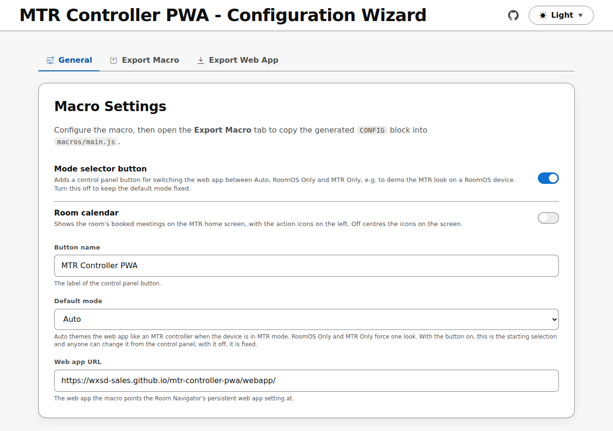</picture></a> | <a href="https://wxsd-sales.github.io/mtr-controller-pwa/wizard/"><picture><source media="(prefers-color-scheme: dark)" srcset="assets/wizard-export-macro-dark.png"><source media="(prefers-color-scheme: light)" srcset="assets/wizard-export-macro-light.png">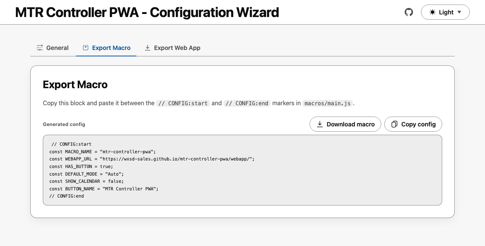</picture></a> | <a href="https://wxsd-sales.github.io/mtr-controller-pwa/wizard/"><picture><source media="(prefers-color-scheme: dark)" srcset="assets/wizard-export-webapp-dark.png"><source media="(prefers-color-scheme: light)" srcset="assets/wizard-export-webapp-light.png">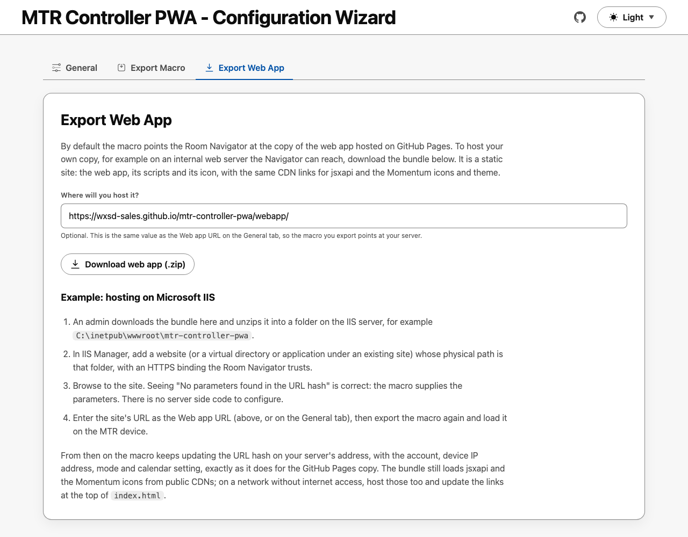</picture></a> |
| **Configuration**: pick the options for your macro                                                                                                                                                                                                                                                                                                                      | **Export Macro**: copy or download the macro, ready for the device                                                                                                                                                                                                                                                                                                  | **Export Web App**: download a static copy of the web app to host yourself                                                                                                                                                                                                                                                                                               |

1. **Configure** the macro with the options below.
2. **Export the macro** and add it to the MTR device's Macro Editor.
3. Pair a Room Navigator with the device and set it to run the persistent web app. The macro fills in the URL it loads.
4. Optional: **export the web app** to host it on your own static web server (for example Microsoft IIS), then enter that URL in the wizard and export the macro again. The macro keeps updating the URL hash on your server just the same.

| Setting       | Macro value     | What it does                                                          |
| ------------- | --------------- | --------------------------------------------------------------------- |
| Mode button   | `HAS_BUTTON`    | Adds the control panel button for switching modes                     |
| Default mode  | `DEFAULT_MODE`  | The mode used until someone picks one (fixed when there is no button) |
| Room calendar | `SHOW_CALENDAR` | Shows bookings on the MTR home screen                                 |
| Button name   | `BUTTON_NAME`   | The control panel button's label                                      |

## Live URLs

- Wizard: https://wxsd-sales.github.io/mtr-controller-pwa/wizard/
- Web app: https://wxsd-sales.github.io/mtr-controller-pwa/webapp/

## License

All contents are licensed under the MIT license. Please see [license](LICENSE) for details.

## Disclaimer

Everything included is for demo and Proof of Concept purposes only. Use of the site is solely at your own risk. This site may contain links to third party content, which we do not warrant, endorse, or assume liability for. These demos are for Cisco Webex use cases, but are not Official Cisco Webex Branded demos.

## Questions

Please contact the WXSD team at [wxsd@external.cisco.com](mailto:wxsd@external.cisco.com?subject=mtr-controller-pwa) for questions. Or, if you're a Cisco internal employee, reach out to us on the Webex App via our bot (globalexpert@webex.bot). In the "Engagement Type" field, choose the "API/SDK Proof of Concept Integration Development" option to make sure you reach our team.
